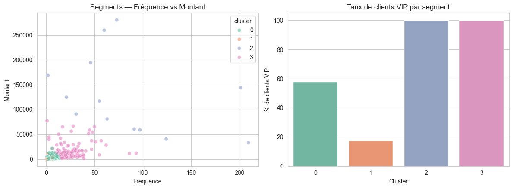
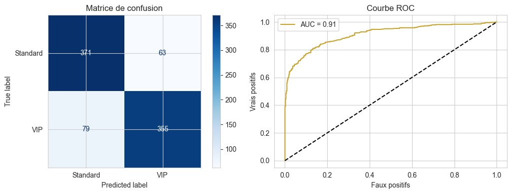
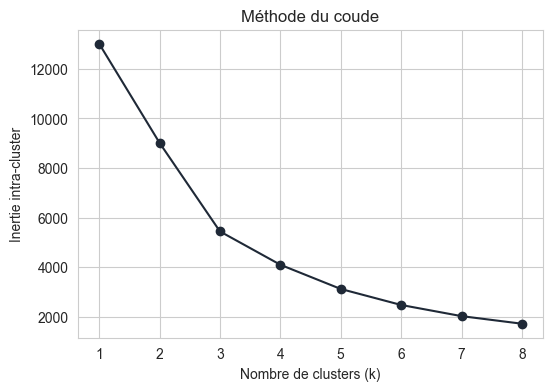
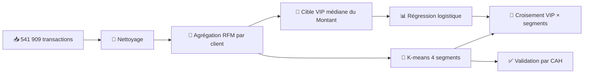
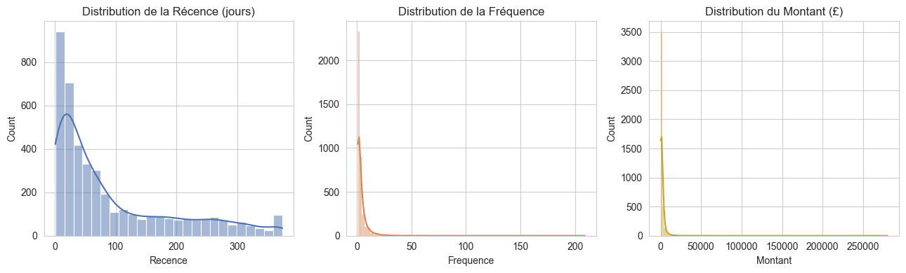
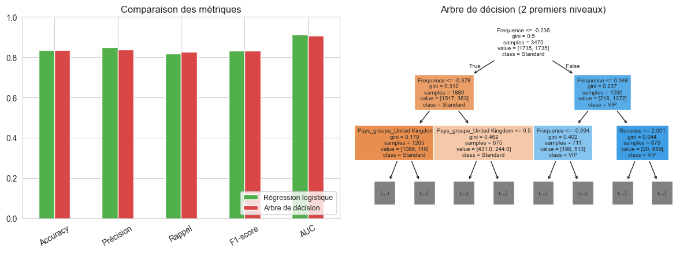
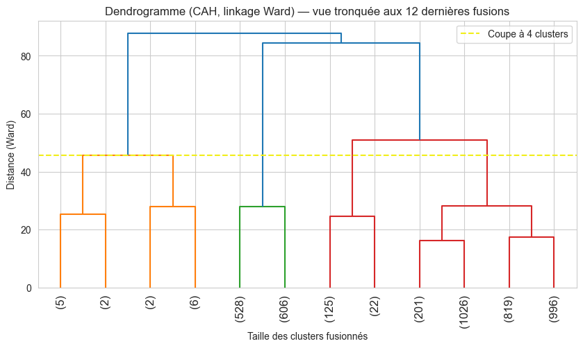

<div align="center">

# 🛒 Segmentation Client & Prédiction de la Valeur Client

### Analyse RFM + Machine Learning sur des données e-commerce réelles

*Data Science & Analytics • Machine Learning • Python • SQL • Big Data*

<br>


<br>

[📄 Rapport](report/) · [📓 Notebook](notebooks/mini_projet_online_retail_RFM.ipynb) · [📊 Résultats](#-résultats) · [🚀 Lancer le projet](#-installation-et-lancement)

</div>

---

> **🇬🇧 EN —** Customer segmentation and high-value-customer prediction on the UCI *Online Retail* dataset (541,909 transactions, UK e-commerce, 2010–2011). Raw transactions are cleaned and aggregated into an RFM table of 4,338 customers. A **logistic regression** predicts VIP customers (**AUC 0.911**), a **K-means** model (k = 4, elbow method) segments the customer base, and the two are cross-validated with a crosstab. Segmentation stability is confirmed with hierarchical clustering (ARI 0.904). Master's project (Data Mining), Ibn Tofaïl University.

## ✨ Points clés

| | |
|---|---|
| 🎯 **Problème** | Une équipe marketing qui traite tous ses clients de la même façon gaspille du budget : qui sont les clients les plus précieux, et lesquels sont en train de partir ? |
| 🧹 **Données** | 541 909 transactions brutes → **4 338 clients** après nettoyage et agrégation RFM |
| 🤖 **Méthodes** | **Prédictive** : régression logistique (VIP) · **Descriptive** : K-means (4 segments), validé par CAH |
| 💡 **Résultat** | 2 segments (« Champions » et « Hyper-champions », **4,9 %** des clients) sont **100 % VIP**, contre 17,7 % pour les « Dormants » |

## 📸 Aperçu des résultats

<p align="center">
  
</p>

<p align="center">
  
  
</p>

## 🗂️ Dataset

[**Online Retail**](https://archive.ics.uci.edu/dataset/352/online+retail) (UCI Machine Learning Repository) : transactions réelles d'un site e-commerce britannique entre décembre 2010 et décembre 2011. Publié à l'origine dans Chen, Sain & Guo (2012) pour l'analyse RFM.

| Variable | Description |
|---|---|
| `InvoiceNo` | Numéro de facture (préfixe `C` = annulation) |
| `StockCode`, `Description` | Code et nom du produit |
| `Quantity` | Quantité (négative en cas de retour) |
| `InvoiceDate` | Date et heure |
| `UnitPrice` | Prix unitaire en £ |
| `CustomerID` | Identifiant client (absent pour les achats invités) |
| `Country` | Pays de livraison (38 valeurs) |

## 🧠 Méthodologie

Le projet suit les cinq étapes du processus **KDD** : sélection, prétraitement, transformation, data mining, interprétation.



### 1. Prétraitement

| Problème | Traitement | Justification |
|---|---|---|
| `CustomerID` manquant (**24,9 %**) | Suppression | Mécanisme **MNAR** (achats invités) : impossible d'imputer un identifiant |
| 5 268 doublons | Suppression | Lignes strictement identiques |
| Retours / annulations (préfixe `C`), prix nuls | Retrait | On étudie le comportement d'achat réel |
| Outliers de quantité et de prix | **Conservés** | Revendeurs professionnels : information métier, pas des erreurs |

**541 909 → 392 692 lignes** exploitables.

### 2. Table RFM

| Indicateur | Définition |
|---|---|
| **R**écence | Jours écoulés depuis le dernier achat |
| **F**réquence | Nombre de commandes distinctes |
| **M**ontant | Total dépensé (£) |

<p align="center">
  
</p>

Les trois distributions sont fortement asymétriques à droite : une minorité de clients génère l'essentiel du chiffre d'affaires (loi de Pareto).

### 3. Cible VIP et prévention de la fuite de données

- **VIP = Montant > médiane** (668,57 £) : 50 % de clients VIP par construction.
- Split **80/20 stratifié**, standardisation ajustée **uniquement sur le train** (pas de *data leakage*).
- `Montant` est **exclu** des variables explicatives, puisqu'il définit la cible.

## 📊 Résultats

### 🔮 Prédiction : régression logistique

| Métrique | Valeur |
|---|---:|
| Accuracy | **0.836** |
| Précision | 0.849 |
| Rappel | 0.818 |
| F1-score | 0.833 |
| **ROC-AUC** | **0.911** |

**Comparaison avec un arbre de décision** (profondeur 4) :

| Modèle | Accuracy | Précision | Rappel | F1 | AUC |
|---|---:|---:|---:|---:|---:|
| **Régression logistique** | 0.836 | 0.849 | 0.818 | 0.833 | **0.911** |
| Arbre de décision | 0.834 | 0.839 | 0.827 | 0.833 | 0.908 |

Performances quasi identiques : la relation RFM → VIP est essentiellement linéaire. La régression logistique est donc retenue, car ses **odds ratios** sont directement lisibles par une équipe marketing.

<p align="center">
  
</p>

### 🎯 Segmentation : K-means (k = 4)

| Segment | Récence (j) | Fréquence | Montant moyen | Effectif | % VIP |
|---|---:|---:|---:|---:|---:|
| 🏆 **Hyper-champions** (grossistes) | 7,4 | 82,5 | 127 188 £ | 13 (0,3 %) | **100 %** |
| 🥇 **Champions** | 15,5 | 22,3 | 12 690 £ | 204 (4,7 %) | **100 %** |
| 🙂 **Clients standards actifs** | 43,7 | 3,7 | 1 354 £ | 3 054 (70,4 %) | 57,7 % |
| 💤 **Dormants** | 248,1 | 1,6 | 479 £ | 1 067 (24,6 %) | 17,7 % |

### ✅ Validation par classification hiérarchique (CAH)

Les 4 segments K-means sont comparés à ceux d'une CAH (linkage Ward) : **Adjusted Rand Index = 0,904**. Les segments « Hyper-champions » et « Dormants » se retrouvent **à l'identique**, ce qui confirme que la segmentation n'est pas un artefact de K-means.

<p align="center">
  
</p>

## 💼 Recommandations marketing

| Segment | Action proposée |
|---|---|
| 🏆 Hyper-champions / Champions | Programme de fidélité premium, gestionnaire de compte dédié, offres B2B |
| 🙂 Standards actifs | Ventes croisées, incitation à augmenter la fréquence d'achat |
| 💤 Dormants | Campagnes de réactivation ciblées, offre de retour limitée dans le temps |

> **Au-delà des métriques**, le projet passe d'un score individuel abstrait à une **grille de décision par segment**, directement exploitable par une équipe CRM.

## ⚠️ Limites

- **Domination de la variable Fréquence** (odds ratio ≈ 1950 par écart-type) : elle est mécaniquement proche du Montant, qui sert à définir la cible. Le score de 0,911 est donc à lire avec cette réserve.
- **Seuil VIP médian** : choix pédagogique (50 % de VIP). En entreprise, le seuil serait fixé selon un objectif business (ex. top 20 % des clients).
- **RFM classique** : pas de variables comportementales enrichies (panier moyen, délai inter-achats).
- **Données historiques** (2010-2011) d'un seul site : pas de validation temporelle sur une période ultérieure.

## 🚀 Installation et lancement

```bash
# 1. Cloner
git clone https://github.com/Bilal-Jellaoui/customer-segmentation-rfm.git
cd customer-segmentation-rfm

# 2. Environnement virtuel
python -m venv venv
venv\Scripts\activate            # Windows
# source venv/bin/activate       # Linux / macOS

# 3. Dépendances
pip install -r requirements.txt

# 4. Ouvrir le notebook
jupyter notebook notebooks/mini_projet_online_retail_RFM.ipynb
```

Le jeu de données doit se trouver dans `data/dataset.csv.zip` (fichier zip lu directement par `pandas`, sans le décompresser). Téléchargement : [UCI Online Retail](https://archive.ics.uci.edu/dataset/352/online+retail).

## 📁 Structure du dépôt

```
customer-segmentation-rfm/
├── README.md
├── requirements.txt
├── data/
│   └── dataset.csv.zip              # Online Retail (UCI)
├── notebooks/
│   └── mini_projet_online_retail_RFM.ipynb
├── docs/
│   └── figures/                     # Graphiques du notebook
└── report/
    └── rapport_RFM_Bilal_Jellaoui.pdf
```

## 🛠️ Compétences mises en œuvre


## 👤 Auteur

**Bilal Jellaoui** · [GitHub](https://github.com/Bilal-Jellaoui) · [LinkedIn](https://www.linkedin.com/in/bilal-jellaoui-381594170)

Master Big Data, IA & Applications Avancées : Université Ibn Tofaïl, Faculté des Sciences de Kénitra · 2025–2026
Module : Data Mining · Encadrante : Prof. Sanae Baqqass · [LinkedIn](https://www.linkedin.com/in/sanae-baqqass-1a88a4206)

🎯 *À la recherche d'un stage de PFE en 2027 : Data Science & Analytics · Machine Learning & Deep Learning · Python · SQL · Big Data.*
